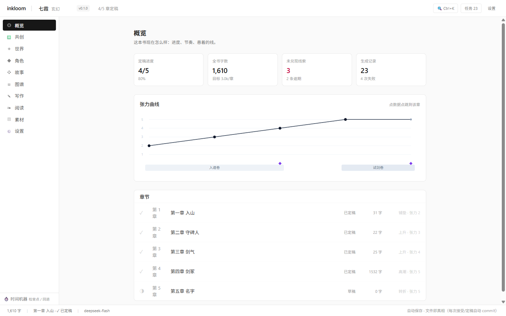
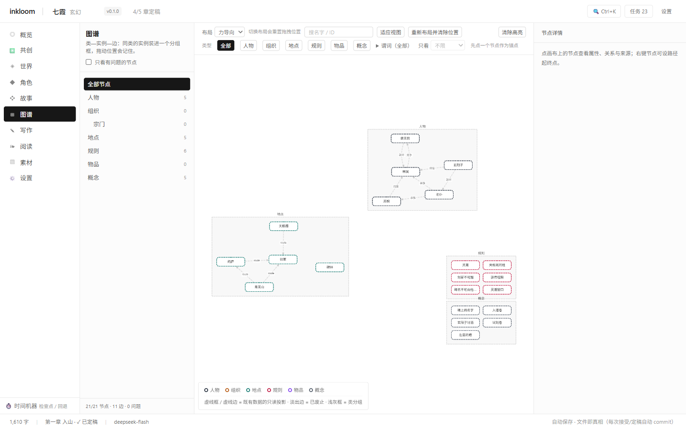
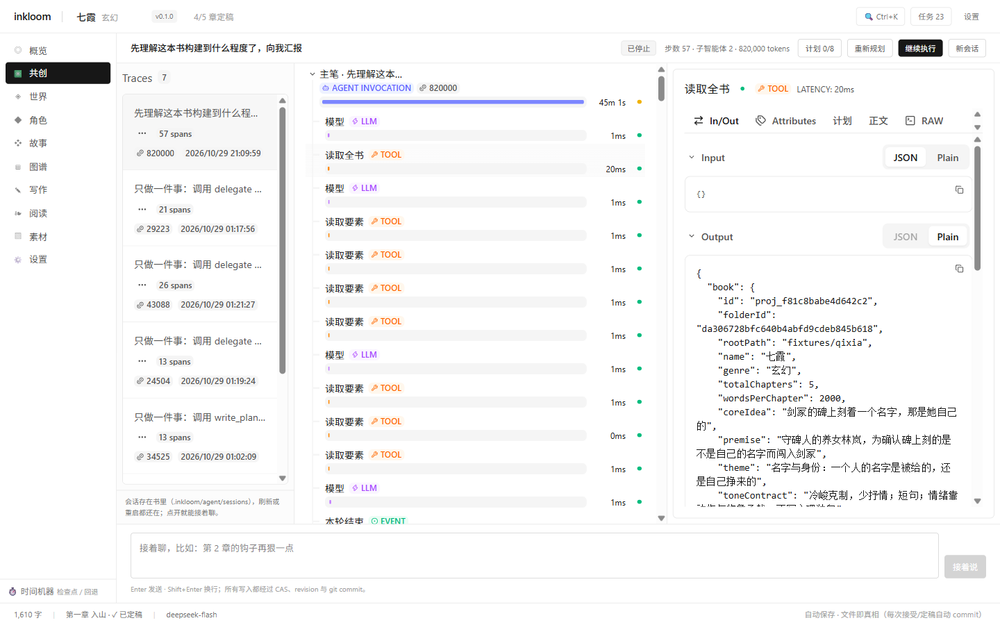

# inkloom

[中文](README.md) · [English](README.en.md)


**Write a long novel with an AI that proposes, never overwrites.** A book is a folder: prose in Markdown, world state in JSON, history in Git. Delete the app — your manuscript stays.


## Not another AI writing tool

| | inkloom | Typical AI writers |
|---|---|---|
| Where the data lives | Local folder — `git clone` it, copy it, back it up | Someone else's database |
| What the AI may do | Propose only: plans need your approval, prose needs your accept | Rewrite your draft directly |
| Long-form structure | World, characters, threads, pacing are structured data | One long chat |
| History | Every accept is a commit; roll back anytime | Undo stack |

## Ten modules

Overview · Co-create · World · Characters · Story · Graph · Writing · Reading · Assets · Settings

| Overview: progress, tension curve, open threads | Graph: elements grouped by type, layout remembered |
|---|---|
|  |  |

## Co-create Agent: plan first, write later



- **Plan-gated**: the agent calls `write_plan`; nothing touches world state or prose until you approve
- **Multi-agent**: `delegate('researcher')` sends sub-agents to search and read the web, with step and token budgets that stop honestly
- **Consistency gate**: before a task can be marked done, a sub-agent checks it against the whole book — contradictions return `error` and the task stays open
- **Full trace**: every span's latency, tokens, input and output are inspectable; sessions live inside the book and survive restarts

## Prose, typeset as a book

Two-page spread, chapter title page, real CSS multi-column pagination (not fake scrolling): `←` `→` to turn, `c` for contents, `f` for full immersion, four font sizes, position remembered, single-page fallback on narrow screens.

## Desktop app: double-click and go


A Tauri 2 shell with a bundled local server — no browser, no Node install; random port, single instance, exits cleanly with the window. Library defaults to `~/inkloom`; keys live in `%APPDATA%\inkloom\.env` (survive uninstall).

## Getting started

### Desktop (Windows, recommended)

Download `inkloom_0.1.0_x64-setup.exe` from [Releases](https://github.com/nancunda/inkloom/releases/latest), install, launch from the Start menu.

### Portable (no install)

Download `inkloom-0.1.0-win-x64.zip` → unzip → run `start.bat` → open `http://127.0.0.1:8787`.

### From source

```bash
pnpm install

# Terminal 1: API (127.0.0.1:8787, no auth, loopback only)
pnpm api

# Terminal 2: web (Vite, proxies /api to 8787)
pnpm web                # → http://localhost:5173

# Desktop shell (needs a Rust toolchain)
pnpm --filter @inkloom/desktop dev
```

To package the desktop app: `node scripts/build-release.mjs` then `pnpm --filter @inkloom/desktop build`.

### Environment

Put these in `.env` at the repo root (dev), next to `start.bat` (portable), or use the in-app Settings page (desktop → `%APPDATA%\inkloom\.env`).

| Variable | Purpose |
|---|---|
| `DEEPSEEK_API_KEY` | Prose generation, co-create agent |
| `SILICONFLOW_API_KEY` | Character portraits (Kolors), judge layer |
| `TAVILY_API_KEY` | Web search (optional) |
| `SEARXNG_BASE_URLS` | Optional: comma-separated SearXNG instances (DuckDuckGo fallback without a key) |
| `INKLOOM_LIBRARY` | Library root, defaults to `~/inkloom` |
| `INKLOOM_CRITIC` | Consistency check before task completion, default `on`; `off` disables |
| `INKLOOM_JUDGE` | Judge layer: `off` (default) / `mock` / `openai` / `typesafe` |

Without keys you can still browse, import, edit, export and roll back — just no model calls.

## Architecture

| Rule | Meaning | Enforced by |
|---|---|---|
| **Files are the only source of truth** | A book is a folder; prose is `.md` | `pnpm check-deps` |
| **`core` has zero IO** | Pure functions, no fs/network/db | dependency scan |
| **Elements are append-only** | Never UPDATE; rollback creates a new version | JSONL history + serialized writes |
| **Prose never enters revisions** | Prose history belongs to Git | no `draft_segment` in `EntityRevision` |
| **Derived layers are disposable** | Index and agent logs stay out of history | book-level `.gitignore` + self-healing on boot |

```
a-book/
├── novel.json                  identity anchor and length settings
├── chapters/ch-001.md          finalized prose (one file per chapter)
├── chapters/ch-001/scenes/     candidate scenes sN.vM.md (always a new version)
├── characters/ story/ world/   structured elements (whole-table writes + CAS)
└── .inkloom/                   index (rebuildable), revision history, agent journal
```

| Package | Responsibility |
|---|---|
| `packages/shared` | Zod schemas + unified error types |
| `packages/core` | Segment markers, versions, state derivation, diff (zero IO) |
| `packages/prompt` | Prompt assembly (cache-friendly + tool protocol) |
| `apps/api` | Storage, services, HTTP routes, agent runtime (the only place with side effects) |
| `apps/cli` | CLI reusing the api service layer |
| `apps/web` | React 19 workbench: HTTP only, SSE for agent events |
| `apps/desktop` | Tauri 2 shell: boot bundled server → probe → navigate the window |

## Verification

```bash
pnpm verify      # biome + tsc + check-deps + 529 unit + 347 integration
```

Real-run evidence (web search, multi-agent, resumed traces, reader, desktop install/uninstall) is logged in [docs/verification.md](docs/verification.md) (Chinese).

## Known gaps

| # | Gap | Impact |
|---|---|---|
| 1 | Agent runs live in memory | A restart loses in-flight runs; sessions and events are persisted, so you can resume |
| 2 | Long sessions are not virtualized | Hundreds of spans can make scrolling and expanding sluggish |
| 3 | No automated UI regression | Interface checked by hand |
| 4 | Agent reasoning streams in English | The model picks the language; prose and tool args are Chinese |

## Version

Current **0.1.0** (2026-10-30): first public release — ten modules plus the Windows desktop app. See [CHANGELOG.md](CHANGELOG.md).
