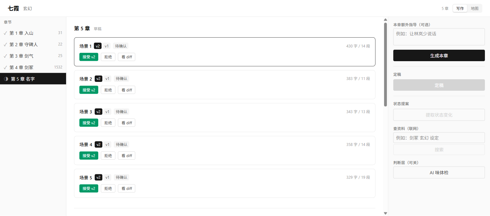

# inkloom

**单用户、本地优先的长篇小说创作工作台。** AI 起草，人确认；要素结构化，过程可回退。

> 反目标：**不做**「一键生成整本小说」的批量流水线。
> 平台不提升 AI 的文笔天花板，它提供的是**可靠性**（跨章不崩）、**可控性**（每步可审可退）、**可视化**（结构看得见）。



---

## 快速开始

### 便携版（无需 Node / pnpm）

1. 从 [Releases](https://github.com/nancunda/inkloom/releases) 下载 `inkloom-win-x64.zip`
2. 解压到任意目录
3. 双击 `start.bat`（或命令行运行 `start.bat`）
4. 浏览器打开 **http://127.0.0.1:8787**

内置 Node 运行时与示例书《七霞》，解压即用。想用自己的书：把 `INKLOOM_BOOK` 指向你的书目录再启动。

> 生成正文需要 `DEEPSEEK_API_KEY`（可选），写在 `start.bat` 同目录的 `.env` 里：
> `DEEPSEEK_API_KEY=sk-…`。没有 key 也能浏览、导入、编辑与导出，只是不能调模型。

### 开发版

```bash
pnpm install

# 终端 1：API（默认 127.0.0.1:8787，无鉴权，因此默认只绑本机）
INKLOOM_BOOK=fixtures/qixia pnpm api

# 终端 2：前端（Vite，/api 代理到 8787）
pnpm web                # → http://localhost:5173
```

只跑一个端口也行：先 `pnpm --filter @inkloom/web build`，再启动 API，访问 8787 就是完整界面。

---

## 一条章的生命周期

```bash
pnpm cli create ./my-novel --name 七霞 --genre 玄幻    # 建书（目录树 + 身份锚 + Git 初始提交）
pnpm cli write ./my-novel --chapter 1                  # 生成候选场景（DeepSeek）
pnpm cli scenes ./my-novel --chapter 1                 # 看场景与状态
pnpm cli diff ./my-novel --chapter 1 --scene 1 --from 1 --to 2
pnpm cli accept ./my-novel --chapter 1 --scene 1 --version 2
pnpm cli rewrite ./my-novel --chapter 1 --scene 1 --version 2 --seg k3t1 --guidance "更克制"
pnpm cli finalize ./my-novel --chapter 1               # 定稿（还有 candidate 时拒绝）
pnpm cli propose ./my-novel --chapter 1                # 状态提案（不落库）
pnpm cli unfinalize ./my-novel --chapter 1             # 撤销定稿：正文反解回场景
```

已有稿件可直接导入：`pnpm cli import ./my-novel --from novel.txt --name 七霞 --genre 玄幻`
（按「第X章 / Chapter N」切章，无标题则整本一章，所有降级都进 warnings）

**三条不变量**

| 不变量 | 含义 |
|---|---|
| accepted 互斥 | 同场景同一时刻只有一个 accepted 版本，接受新版本时旧版自动 rejected |
| diff 不参与落库 | diff 只用于展示；写什么以你接受哪个版本为准 |
| 状态提案只提案 | LLM 只输出「角色\|字段\|新值\|证据」，逐条确认后才写 revision |

---

## 四个视图

| | |
|---|---|
|  |  |
| **关系网络**：角色圆环，七种关系着色；**拖两个节点连线直接建立关系**，时间滑块看第 N 章时谁和谁是什么关系 | **线索轨迹**：每条伏笔一行，横轴章号；**线断在右边 = 还没回收**，逾期标红 |
|  |  |
| **世界地图**：地点按类型着色，路线标天数（系统算，AI 不得改），单向路线画箭头 | **专注模式** `Ctrl+Shift+E`：全屏、无侧栏、无 AI，点任意一段就地改写 |

命令面板 `Ctrl+K`：输入章名或命令，↑↓ 选择、Enter 执行。

---

## 架构

| 铁律 | 含义 | 强制手段 |
|---|---|---|
| **文件是唯一事实源** | 一本书 = 一个文件夹，正文是 `.md`。删掉软件，稿子还在 | `pnpm check-deps` |
| **`core` 零 IO** | 纯函数，不碰文件/网络/数据库 | `scripts/check-deps.mjs` 扫描 import |
| **要素 append-only** | 永不 UPDATE，回退 = 产生新版本 | JSONL 历史 + 写入串行队列 |
| **正文不进 revision** | 正文历史只归 Git，两套版本系统会互相打架 | `EntityRevision` 类型里没有 `draft_segment` |

```
一本书/                        索引（可丢弃）      版本
├── novel.json                  .inkloom/          book/.git
├── chapters/ch-001.md            index.sqlite      每次接受/定稿自动提交
├── chapters/ch-001/scenes/       （reindex 可全量重建）
├── characters/ story/ world/
└── assets/
```

| 包 | 职责 |
|---|---|
| `packages/shared` | Zod schema + 统一错误类型 |
| `packages/core` | 段标记、版本、状态推导、diff、判断层接口（零 IO） |
| `packages/prompt` | Prompt 装配（S1–S5 缓存友好 + U1–U9） |
| `apps/api` | 存储 + 服务层 + HTTP 路由（唯一有副作用的地方） |
| `apps/cli` | 命令行，复用 api 服务层 |
| `apps/web` | React 19 写作页 + 地图四视图，只读 HTTP |

---

## 判断层（可开关）

Tier 2 判断层只输出选项 / 分数 / 是否，**从不生成一个字**。

```bash
INKLOOM_JUDGE=off        # 默认：不调用，不花钱
INKLOOM_JUDGE=mock       # 固定脚本，验证管线
INKLOOM_JUDGE=openai     # 硅基流动（国内可用），需 SILICONFLOW_API_KEY
INKLOOM_JUDGE=typesafe   # TypeSafe 官方 JEV，需 TYPESAFE_API_KEY
```

界面上点「AI 味体检」：每场景三问（反 AI 味 / 节奏 / 一致性），置信度 < 0.75 的结论标「不注入」——阈值不是装饰。
判断层挂掉只降级，不阻塞写作。

---

## 验证

```bash
pnpm verify      # biome + tsc + check-deps + 287 测试（27 文件）
pnpm verify:p0   # 建书 / 索引 / 回退 / 导出        11 条
pnpm verify:p1a  # 装配 → 生成 → 落盘                6 条
pnpm verify:p1b  # 确认 / diff / 定稿 / 提案        11 条
pnpm verify:p1c  # HTTP 接口 + 启动自愈             18 条
pnpm verify:p2a  # 局部重写                          7 条
pnpm verify:p2c  # 判断层开关 / 降级 / 只读          7 条
```

**已完成**：P0 数据底座 → P1 单章共创（生成 / 逐场景确认 / diff / 定稿 / 状态提案）→ P2 局部重写 · txt-md 导入 · 判断层 · 关系网络 · 联网搜索 · 异步生成 → P3 视觉锚点 → P4 人物形象（生图落盘 + Asset 可复现）。

**已知缺口**

| # | 缺口 | 影响 |
|---|---|---|
| 1 | TypeSafe 官方 API 从 CN 出口返回 451 | 判断层实际用硅基流动；`typesafe` provider 已就绪 |
| 2 | 前端无 Playwright 自动化回归 | 界面回归靠手工 + Chrome MCP |
| 3 | 生图 seed 不可控（Kolors 不支持） | 复现靠 prompt + params 记录 |
| 4 | 生成任务表在内存 | 服务重启丢未完成任务；结果已落盘，重提即可 |

**明确不做**：并行生成多场景（邻场景正文不存在时章内因果必然丢失，spec 定为实验开关且默认关闭）；写作 Skill 市场（需要社区载体）。
