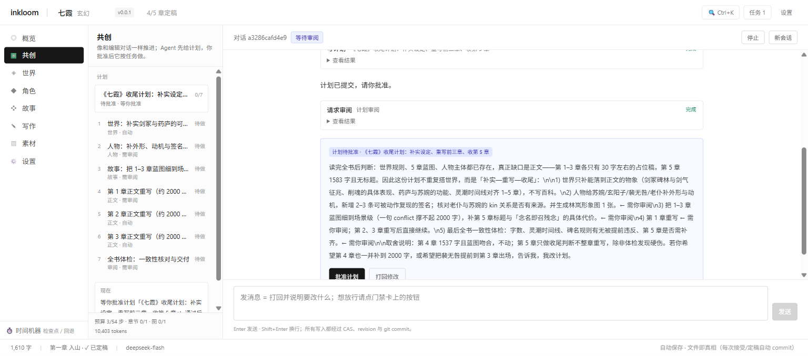
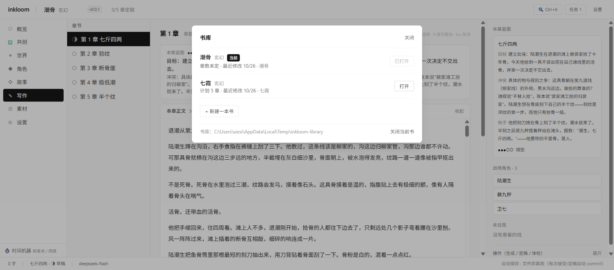
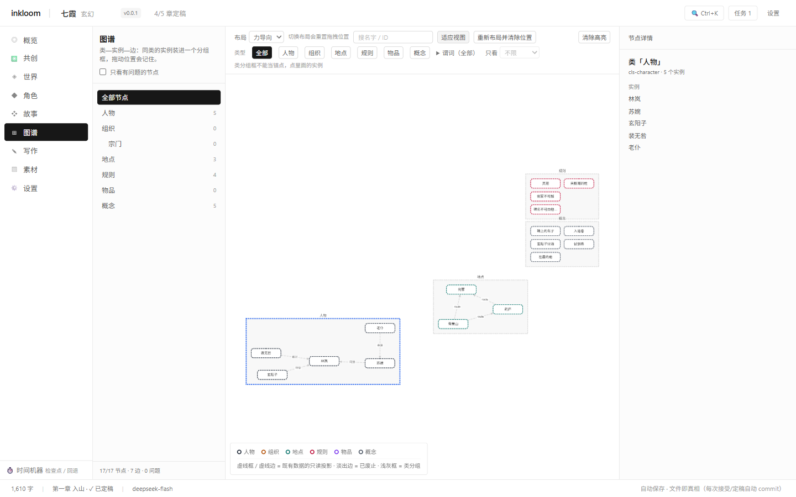
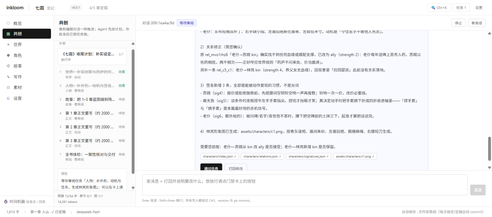
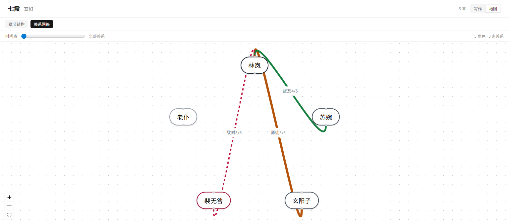
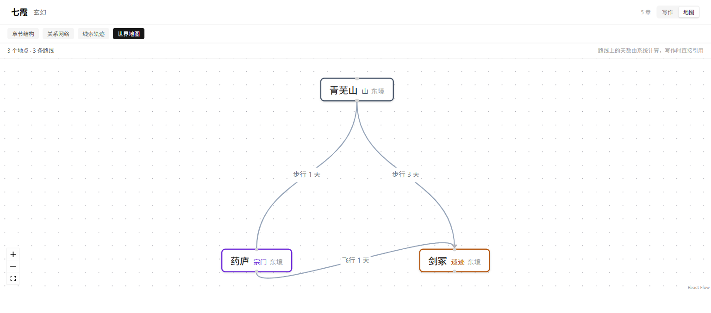
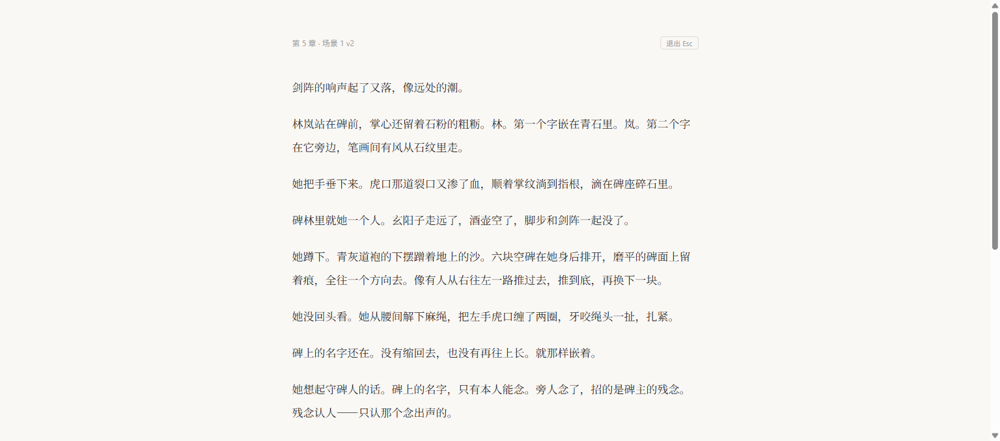
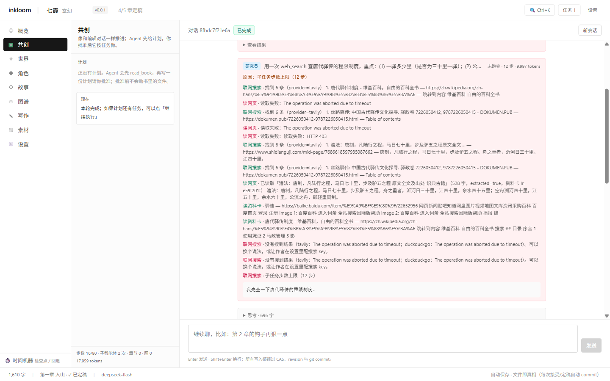

# inkloom

**本地优先的长篇小说创作工作台：AI 起草，人确认；要素结构化，过程可回退。**

> 不做「一键生成整本小说」的批量流水线。
> inkloom 提供的是**可靠性**（跨章不崩）、**可控性**（每步可审可退）、**可视化**（结构看得见）。



---

## 它是什么

一本书就是一个文件夹：正文是 Markdown，要素是 JSON，版本历史是书内的 Git 仓库。
删掉软件，稿子还在；换台机器，`git clone` + 重建索引就能接着写。

八个模块：

| 模块 | 干什么 |
|---|---|
| **概览** | 定稿进度、张力曲线、未兑现线索、生成记录 |
| **共创** | 和 Agent 对话：它先写计划，你批准后按任务自主执行；可派只读子智能体考据/核对，任务完成前自动查矛盾；需要拍板处停下 |
| **世界** | 规则、力量体系、地点与路线（地图上拖拽） |
| **角色** | 角色卡、关系网络（拖两个节点连线建关系）、形象图 |
| **故事** | 卷、故事弧、逐章蓝图、线索轨迹 |
| **图谱** | Cytoscape 复合图：类=分组框、实例=节点、拖拽记住位置；按类型/谓词/跳数过滤，右键查两点路径 |
| **写作** | 场景候选、diff、接受/拒绝、整场重写、定稿、专注模式 |
| **素材** | 形象图与参考资产（prompt / provider / params 可复现） |
| **设置** | 模型、密钥、判断层开关 |

所有写入都经过 **CAS → revision → 索引同步 → git commit**。
时间机器随时回退；回退不是"删记录"，而是产生一个新的真实状态。

---

## 书库：一个文件夹管所有书



- 书库根目录默认 `~/inkloom`（`INKLOOM_LIBRARY` 可覆盖），**一级子目录 = 一本书**
- 每本书仍是独立文件夹（自带 Git 与索引），可以整个拷进 / 拷出书库
- 顶栏点书名切换书；切书会整页重载，并清掉上一本的查询缓存与 Agent runId
- 空书库是正常状态：直接在浏览器里「新建一本书」
- 切书前要求没有进行中的共创会话 / 生成任务——避免把进度写进另一本书

---

## 图谱：看得见的世界模型



- 画布是 Cytoscape 复合图：每个类一个分组框，实例挂在最具体的类里；`instanceOf` 用父子关系表达，不再单独画边
- 位置会记住：拖过的坐标存在浏览器本地，key 是 `inkloom:graph-layout:<bookId>:<signature>`；书内容一变旧坐标自动作废
- 布局可切：力导向（fcose）/ 层级 / 同心圆 / 网格；双击类框折叠；切换布局会重置拖拽位置（工具栏有提示）
- 过滤与搜索：节点类型多选、谓词多选、左栏类树、「只看 N 跳邻居」；搜索命中会高亮并聚焦
- 路径：右键节点设起点 / 终点，右栏逐跳显示「林岚 —师徒→ 玄真」，其余节点淡出
- 人物、地点、规则、线索、卷是**虚拟节点**：来自各自文件，改要去原模块改
- 势力、物品、概念可以写进 `world/ontology/nodes.jsonl`；类与谓词在 `world/ontology/classes.json`
- 跨类型边在 `world/ontology/edges.jsonl`（append-only，带章节区间与来源）
- 坏行不会整页报错：跳过该行并在页面底部列出「第几行坏了」
- 图谱只读：Agent 用 `query_graph` / `find_path` / `explain_fact` 查；改设定走 `write_element`
- 同一套推理也是 HTTP 接口：`GET /api/ontology/path`、`POST /api/ontology/query`、`GET /api/ontology/explain`

---

## 共创 Agent（计划驱动）



像和一位总编对话，而不是提交一个批处理任务：

- **先计划，后执行**：Agent 读完全书 → `write_plan` 提交 4–8 个任务 → 你批准 → 它逐项执行；每个任务写明技能、完成标准、是否需要你审阅
- **任务门禁**：需要审阅的任务完成后停下；通过 → 自动进入下一个任务，打回 → 带意见重做，跳过 → 记为已跳过并继续
- **随时说话**：运行中发消息会 `steer` 到当前步之后；**等待审阅时发消息 = 带意见打回**
- **连续会话**：本轮完成后可以接着聊（"第 5 场扩一下""下一章蓝图改狠一点"），不重开任务
- **可恢复**：计划从书里读取（刷新 / 服务重启后仍在）；停止、预算耗尽后「继续执行」从没做完的任务接着做，计划作废了可「重新规划」
- **全程可见**：思考折叠、工具卡片与结果、产物一键跳到对应模块
- **预算**：`80 + 2 × 任务数` 步工具调用保护；章节与形象图不设额度，一个会话可连写多章；用完显示「已暂停」，点「继续执行」接着跑
- **可联网**：Agent 有 `web_search` / `read_url` / `read_lore`；结果落资料卡，默认未批准，作者批准后才进 prompt。写作页右栏的「资料卡」列表可以直接批准/删除。
- **多智能体**：主 Agent 用 `delegate` 派只读子智能体——`researcher` 联网考据、`worldbuilder` 梳理设定与图谱、`critic` 核对矛盾、`stylist` 提文风建议。子体只拿到「任务 + 背景」（看不到主对话），卡片上能看到角色、步数、tokens 与每次工具调用。
- **一致性门禁**：任务 `done` 前自动派 `critic` 核对产物与设定/正文；`error` 级矛盾会拦住完成（任务保持未完成并回传证据），检查器自身出错或超时则放行并标注「检查未完成」。`INKLOOM_CRITIC=off` 可关闭。
- **技能**：`world` 世界、`characters` 人物、`story` 故事、`chapter` 正文、`review` 审阅、`free` 自由

Agent 侧工具：`read_book`、`read_element`、`web_search`、`read_url`、`read_lore`、
`write_element`、`write_blueprint`、`write_plan`、`update_plan`、`update_task`、
`request_review`、`generate_chapter`、`generate_portrait`、`delegate`。

计划定义存 `story/plans/<id>.json`（进 Git，可审阅 / 回滚）；执行状态存
`.inkloom/agent/plans/<id>.state.json`（不进 Git，随运行更新）。
运行在 [Pi Agent](https://github.com/earendil-works/pi)（MIT）+ DeepSeek `deepseek-flash`；
密钥只在服务端环境变量里，浏览器不接触。

---

## 快速开始

### 便携版（无需 Node / pnpm）

1. 从 [Releases](https://github.com/nancunda/inkloom/releases) 下载 `inkloom-win-x64.zip`
2. 解压到任意目录
3. 双击 `start.bat`
4. 浏览器打开 **http://127.0.0.1:8787**

内置 Node 运行时与示例书《七霞》。启动后在书库里打开它，或新建一本。

### 开发版

```bash
pnpm install

# 终端 1：API（默认 127.0.0.1:8787，无鉴权，因此只绑本机）
# 书库默认 ~/inkloom；想放别处：INKLOOM_LIBRARY=./books pnpm api
pnpm api

# 终端 2：前端（Vite，/api 代理到 8787）
pnpm web                # → http://localhost:5173
```

只跑一个端口也行：先 `pnpm --filter @inkloom/web build`，再启动 API，访问 8787 就是完整界面。

### 环境变量

写在仓库根目录的 `.env`（开发版）或 `start.bat` 同目录的 `.env`（便携版）：

| 变量 | 用途 |
|---|---|
| `DEEPSEEK_API_KEY` | 生成正文、共创 Agent |
| `SILICONFLOW_API_KEY` | 人物形象图（Kolors） |
| `TAVILY_API_KEY` | 联网搜索（可选） |
| `SEARXNG_BASE_URLS` | 可选：SearXNG 实例，逗号分隔（无 key 时仍可用 DuckDuckGo 兜底） |
| `INKLOOM_LIBRARY` | 书库根目录，默认 `~/inkloom` |
| `INKLOOM_BOOK` | 可选：启动时直接打开某本书（路径） |
| `INKLOOM_CRITIC` | 任务完成后的一致性检查，默认 `on`；`off` 关闭（下次会话生效） |

没有 key 也能浏览、导入、编辑、导出与回退，只是不能调模型。

---

## 一条章的生命周期（CLI）

```bash
pnpm cli create ./my-novel --name 七霞 --genre 玄幻    # 建书（目录树 + 身份锚 + Git 初始提交）
pnpm cli write ./my-novel --chapter 1                  # 生成候选场景（DeepSeek）
pnpm cli scenes ./my-novel --chapter 1                 # 看场景与状态
pnpm cli diff ./my-novel --chapter 1 --scene 1 --from 1 --to 2
pnpm cli accept ./my-novel --chapter 1 --scene 1 --version 2
pnpm cli rewrite ./my-novel --chapter 1 --scene 1 --version 2 --seg k3t1 --guidance "更克制"
pnpm cli finalize ./my-novel --chapter 1               # 定稿（还有 candidate 时拒绝）
pnpm cli propose ./my-novel --chapter 1                # 状态提案（不落库）
pnpm cli unfinalize ./my-novel --chapter 1             # 撤销定稿：正文反解回场景
```

已有稿件可直接导入：`pnpm cli import ./my-novel --from novel.txt --name 七霞 --genre 玄幻`
（按「第X章 / Chapter N」切章，所有降级都进 warnings）

**三条不变量**

| 不变量 | 含义 |
|---|---|
| accepted 互斥 | 同场景同一时刻只有一个 accepted 版本，接受新版本时旧版自动 rejected |
| diff 不参与落库 | diff 只用于展示；写什么以你接受哪个版本为准 |
| 状态提案只提案 | LLM 只输出「角色\|字段\|新值\|证据」，逐条确认后才写 revision |

---

## 结构与可视化

| | |
|---|---|
|  |  |
| **关系网络**：拖两个节点连线直接建关系；时间滑块看第 N 章时谁和谁是什么关系 | **线索轨迹**：每条伏笔一行，横轴章号；线断在右边 = 还没回收，逾期标红 |
|  |  |
| **世界地图**：地点按类型着色，路线标天数（系统算，AI 不得改），单向路线画箭头 | **专注模式** `Ctrl+Shift+E`：全屏、无侧栏、无 AI，点任意一段就地改写 |

命令面板 `Ctrl+K`：输入章名或命令，↑↓ 选择、Enter 执行。

---

## 架构

| 铁律 | 含义 | 强制手段 |
|---|---|---|
| **文件是唯一事实源** | 一本书 = 一个文件夹，正文是 `.md`。删掉软件，稿子还在 | `pnpm check-deps` |
| **`core` 零 IO** | 纯函数，不碰文件/网络/数据库 | `scripts/check-deps.mjs` 扫描 import |
| **要素 append-only** | 永不 UPDATE，回退 = 产生新版本 | JSONL 历史 + 写入串行队列 |
| **正文不进 revision** | 正文历史只归 Git，两套版本系统会互相打架 | `EntityRevision` 类型里没有 `draft_segment` |
| **派生层可丢弃** | 索引与 Agent 运行日志不进版本历史 | 书内 `.gitignore` + 启动自愈 |

```
一本书/
├── novel.json                  身份锚与篇幅设定
├── chapters/ch-001.md          定稿正文（一章一文件）
├── chapters/ch-001/scenes/     候选场景 sN.vM.md（永远写新版本）
├── characters/ story/ world/   结构化要素（数组文件，整表写入 + CAS）
├── styles/ assets/             文风资产与形象图
└── .inkloom/                   索引（可重建）、revision 历史、Agent journal
```

| 包 | 职责 |
|---|---|
| `packages/shared` | Zod schema + 统一错误类型 |
| `packages/core` | 段标记、版本、状态推导、diff、判断层接口（零 IO） |
| `packages/prompt` | Prompt 装配（S1–S5 缓存友好 + U1–U9） |
| `apps/api` | 存储 + 服务层 + HTTP 路由 + Agent 运行时（唯一有副作用的地方） |
| `apps/cli` | 命令行，复用 api 服务层 |
| `apps/web` | React 19 工作台，只读 HTTP，SSE 接收 Agent 事件 |

---

## 判断层（可开关）

Tier 2 判断层只输出选项 / 分数 / 是否，**从不生成一个字**。

```bash
INKLOOM_JUDGE=off        # 默认：不调用，不花钱
INKLOOM_JUDGE=mock       # 固定脚本，验证管线
INKLOOM_JUDGE=openai     # 硅基流动（国内可用），需 SILICONFLOW_API_KEY
INKLOOM_JUDGE=typesafe   # TypeSafe 官方 JEV，需 TYPESAFE_API_KEY
```

界面上点「AI 味体检」：每场景三问（反 AI 味 / 节奏 / 一致性），置信度 < 0.75 的结论标「不注入」——阈值不是装饰。判断层挂掉只降级，不阻塞写作。

---

## 验证

```bash
pnpm verify      # biome + tsc（含 web）+ check-deps + 428 单元 + 339 集成
pnpm verify:p0   # 建书 / 索引 / 回退 / 导出        11 条
pnpm verify:p1a  # 装配 → 生成 → 落盘                6 条
pnpm verify:p1b  # 确认 / diff / 定稿 / 提案        11 条
pnpm verify:p1c  # HTTP 接口 + 启动自愈             18 条
pnpm verify:p2a  # 局部重写                          7 条
pnpm verify:p2c  # 判断层开关 / 降级 / 只读          7 条
```

**切片 1（共创急救包）真机验收**（2026-10-27，书《七霞》）：

- `POST /api/search`（真实 Tavily key）→ `provider=tavily`、`degraded=false`、3 条命中都带 `snippet` 与 `provider`
- `read_url` 抓 `https://example.com` → `extracted=true`、156 字，落成资料卡；`GET /api/lore` 能看到同一条且 `content` 非空
- 重定向、IP 变体、5MB 上限、步数耗尽空转、reindex 保留资料卡均有单测/集成覆盖
- `generate_chapter` 连写 3 章不再被额度拦住（`plan-tools.test.ts` 等价证据）

**切片 3（多智能体）真机验收**（2026-10-28，书《七霞》）：



- 真实会话里主 Agent 调 `delegate('researcher')`：卡片显示角色、步数、tokens 与每次工具调用；展开能看到 `web_search` / `read_url` / `read_lore` 轨迹与资料卡 id（`lr-e59f201f`）；运行中步数实时刷新，触顶显示「未跑完 · 原因：子任务步数上限」
- 把裴无咎外观改成「双腿齐膝断去」后调 `update_task(done)`：返回 2 处 `error`，任务保持未完成且 `artifacts` 未写入（其中一处是书里原本就有的矛盾：苏婉 22 岁 vs「与父亲三十年只见过三面」）
- `INKLOOM_CRITIC=off` 重跑同一调用：直接 `done`，子智能体调用 0 次

**已完成**：P0 数据底座 → P1 单章共创 → P2 局部重写 · 导入 · 判断层 · 关系网络 · 联网搜索 · 异步生成 → P3 视觉锚点 → P4 人物形象 → **书库（多书切换）· 计划驱动的共创 Agent · 多智能体与一致性门禁**。

**已知缺口**

| # | 缺口 | 影响 |
|---|---|---|
| 1 | TypeSafe 官方 API 从 CN 出口返回 451 | 判断层实际用硅基流动；`typesafe` provider 已就绪 |
| 2 | 前端无 Playwright 自动化回归 | 界面回归靠手工 + Chrome MCP |
| 3 | 生图 seed 不可控（Kolors 不支持） | 复现靠 prompt + params 记录 |
| 4 | Agent run / 生成任务在内存 | 服务重启丢进行中的会话；计划状态与文件已落盘，重启后「继续执行」即可接着做 |
| 5 | Agent 思考流是英文 | 模型自选语言；正文与工具参数是中文 |

**明确不做**：并行生成多场景（邻场景正文不存在时章内因果必然丢失）；写作 Skill 市场（需要社区载体）。
