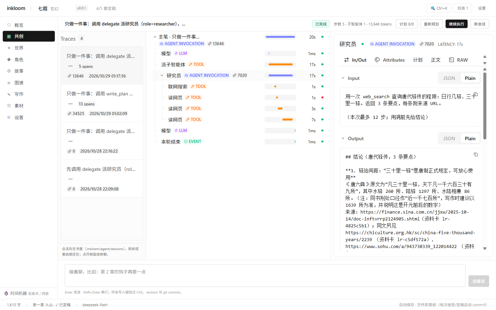
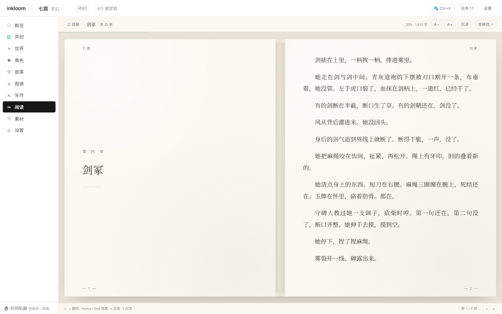

# 真机验收记录

每一条都是跑起来的证据，不是设计意图。环境：Windows 11 25H2，书《七霞》（`fixtures/qixia` 或 `.tmp-library/qixia`）。

## 命令

```bash
pnpm verify      # biome + tsc（含 web）+ check-deps + 529 单元 + 347 集成
pnpm verify:p0   # 建书 / 索引 / 回退 / 导出        11 条
pnpm verify:p1a  # 装配 → 生成 → 落盘                6 条
pnpm verify:p1b  # 确认 / diff / 定稿 / 提案        11 条
pnpm verify:p1c  # HTTP 接口 + 启动自愈             18 条
pnpm verify:p2a  # 局部重写                          7 条
pnpm verify:p2c  # 判断层开关 / 降级 / 只读          7 条
```

## 切片 1：共创急救包（2026-10-27）

- `POST /api/search`（真实 Tavily key）→ `provider=tavily`、`degraded=false`、3 条命中都带 `snippet` 与 `provider`
- `read_url` 抓 `https://example.com` → `extracted=true`、156 字，落成资料卡；`GET /api/lore` 能看到同一条且 `content` 非空
- 重定向、IP 变体、5MB 上限、步数耗尽空转、reindex 保留资料卡均有单测/集成覆盖
- `generate_chapter` 连写 3 章不再被额度拦住（`plan-tools.test.ts` 等价证据）

## 切片 3：多智能体（2026-10-28）


- 真实会话里主 Agent 调 `delegate('researcher')`：卡片显示角色、步数、tokens 与每次工具调用；展开能看到 `web_search` / `read_url` / `read_lore` 轨迹与资料卡 id（`lr-e59f201f`）；运行中步数实时刷新，触顶显示「未跑完 · 原因：子任务步数上限」
- 把裴无咎外观改成「双腿齐膝断去」后调 `update_task(done)`：返回 2 处 `error`，任务保持未完成且 `artifacts` 未写入（其中一处是书里原本就有的矛盾：苏婉 22 岁 vs「与父亲三十年只见过三面」）
- `INKLOOM_CRITIC=off` 重跑同一调用：直接 `done`，子智能体调用 0 次

## 切片 4：trace 视图与会话（2026-10-29，1440×900）



- 新建会话 → 主 Agent `delegate('researcher')` → 树里 5 个 span：主笔 20s → 模型 / 派子智能体 17s / 研究员 17s（下挂 3 次读网页）/ 模型 / 本轮结束；右栏 Output 读到完整结论（3 条要点 + 4 个来源 URL）
- 重跑「查 10 个朝代驿传」：子体用满 12/12 步后按步数纪律自行收尾（`partial=false`，结论 4.7k 字），主 Agent 不中断继续跑（会话共 26 步）；`partial`（琥珀）路径由 `delegate-tools.test.ts` 与 `to-trace.test.ts` 覆盖
- 刷新页面、重启 API 后：6 个会话（含 2 个切片 3 补录的只读历史）全部重新出现，点开能回放完整 span 树
- 真续接：重启后在新 run 里发「把三十里一驿写成一条世界规则」→ 零次 `web_search`、先 `read_element` 比对已有 w1–w5，引用了上一轮的《唐六典》原文与 1639 所/程限分等，并指出会与 w5 重复；`write_element` 被「先有获批计划」的门禁拦住（预期）
- 门禁：计划待批准 → 批准 → 任务待审阅 → 通过 → 已完成；顶栏在门开瞬间就显示「已完成」（不等盘上 meta 的 30 秒节流）

## 阅读器（2026-10-29，1440×900 与 1024×736）



- 1440×900：双页对开，左页是章扉页（第 四 章 / 剑冢 / 细线）、右页正文从第一段开始，页眉「七霞 / 剑冢」、页脚「— 1 — / — 2 —」；未定稿章页脚多一个「草稿」点
- 真分页：第 4 章 86 段被排成 13 列 / 7 屏（17px）或 5 屏（21px），`scrollWidth` 推列数与 `translateX` 平移对得上；长句不会半个字掉到下一列
- 键盘：←/→/PgUp/PgDn/空格 翻屏、Home/End 首尾、`c` 目录、`f` 沉浸、Esc 退出；目录里 ↑↓ 选择 + Enter 跳章可用
- 位置记忆：读到 5/8 刷新 → 仍在 5/8；字号 17→19→21 时按比例换到 4/7 → 5/9，不跳回第一屏
- 沉浸：隐去顶栏与左栏后书页铺满窗口，页码与页眉仍在，Esc 退回
- 窄屏 420/1024：自动退化为单页纵向滚动，无横向溢出；这一轮顺手修掉了重复短句的 React key 冲突

## 桌面版（2026-10-29，Windows 11 25H2）


- 启动：窗口先显示等待页 → 探活成功后才导航到本机端口；截图是 release 版直接跑起来的书库页（七霞 · 打开 / 新建一本书）
- 端口随机：四次启动分别是 58816 / 58525 / 53938 / 61119，不和开发用的 8787 抢
- 单实例：第一个实例在跑时再双击一次 exe，5 秒内自己退出；桌面进程保持 1 个、服务端监听只有 1 处
- 退出清理：关窗口后桌面进程与 node 子进程全部退出、端口释放，不留孤儿
- 配置位置：`GET /api/settings` 返回 `%APPDATA%\inkloom\.env`；`PUT` 写入 `INKLOOM_WORDS_PER_CHAPTER=2800` 后重启应用，该字段 `value=2800` 且 `pendingRestart=false` —— `--env-file-if-exists` 确实生效
- NSIS 安装验收：静默安装 exit 0，快捷方式与卸载项就位；安装态启动后 `libraryRoot=C:\Users\xiesi\inkloom`（默认书库）、空书库页直接显示新建表单
- NSIS 卸载验收：注册表项与开始菜单项清零，`%APPDATA%\inkloom` 保留；安装目录只剩运行时写的日志——所以配置目录必须放在安装目录之外

## 共创页性能与布局（2026-10-29）

- 1440×380 复现输入框被顶出视口（文档高 432 > 视口 380）；修后 `document.scrollHeight === innerHeight`，左栏可滚（scrollH 349 / clientH 265），输入框完整可见
- SSE token 级 delta 改为 80ms 批量入状态；`mergeEvents` 追加快路径（同 run 递增 seq / 全新 run 直接 push），回放与乱序才走 map + 排序
- 8 条单测锁住快路径与回退路径（`apps/web/src/agent-trace/merge-events.test.ts`）

## 进度

**已完成**：P0 数据底座 → P1 单章共创 → P2 局部重写 · 导入 · 判断层 · 关系网络 · 联网搜索 · 异步生成 → P3 视觉锚点 → P4 人物形象 → 书库（多书切换）· 计划驱动的共创 Agent · 多智能体与一致性门禁 · trace 视图与会话续接 · 书页阅读器 · Windows 桌面版。

**已知缺口**

| # | 缺口 | 影响 |
|---|---|---|
| 1 | TypeSafe 官方 API 从 CN 出口返回 451 | 判断层实际用硅基流动；`typesafe` provider 已就绪 |
| 2 | 前端无 Playwright 自动化回归 | 界面回归靠手工 + Chrome MCP |
| 3 | 生图 seed 不可控（Kolors 不支持） | 复现靠 prompt + params 记录 |
| 4 | Agent run / 生成任务在内存 | 服务重启丢进行中的 run；会话索引、事件流与 messages 快照已落盘，重启后点「继续执行」或直接接着聊（真续接） |
| 5 | Agent 思考流是英文 | 模型自选语言；正文与工具参数是中文 |
| 6 | 长会话（数百 span）未做虚拟化 | 共创页滚动与展开可能变卡；本轮只解决 token 级重渲染 |
